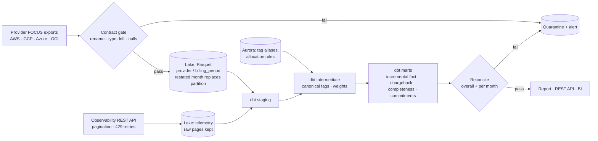

# FinOps Attribution Platform

An end-to-end pipeline that turns raw multi-cloud billing data into **trusted chargeback,
tag-coverage and commitment numbers**. It handles late and restated bills, splits shared cost
using service telemetry, and refuses to publish anything that doesn't tie back to the source.

Built on the FinOps Foundation's **FOCUS 1.0 sample dataset**: 100,000 anonymized real billing
line items from AWS, Azure, Oracle Cloud and a small Google Cloud slice.

```
make setup && make all      # download → ingest → telemetry → dbt build → reconcile → benchmark → report → tests
make restatement-demo       # AWS re-sends September with corrections, late lines and duplicates
make drift-demo             # replay an upstream schema-change incident; the gate blocks it
make scala-test             # Spark/Scala ingestion job: compile + ScalaTest
make scala-run              # run the Scala job on the sample and cross-check it against the Python loader
make dagster                # same pipeline as Dagster assets with blocking data checks
make api                    # chargeback REST API on :8000
```

---

## The problems this solves

| Problem a FinOps data team actually has | What this project does | Where |
|---|---|---|
| AWS, GCP, Azure and OCI bills all have different schemas | Ingests the FOCUS open standard so one model covers every provider | `transform/models/staging/` |
| Upstream renames a field or sends `"$1,234.56"` in a cost column → silent NULLs, fake dip in spend | Contract gate reads every column as text, detects renames and type drift, quarantines the batch (Python **and** Scala) | `ingestion/validate_contract.py`, `ingestion/spark-scala/` |
| Providers re-send the month (late-arriving and restated billing) | A new file **replaces** only the provider/month partitions it contains; manifest tracks the active batch per month; dbt fact is incremental by provider/month (`delete+insert`) | `ingestion/load_raw.py`, `fct_cost_allocated.sql` |
| Duplicate line items | Dropped on load (latest version wins), logged per batch, plus a dedupe guard in staging | `load_raw.py`, `stg_focus__charges.sql`, Scala `transform` |
| Tags are inconsistent (`business_unit` vs `org` vs `" org"` vs `CostCenter`) | Governed alias table resolves them to one owner | `seeds/tag_key_aliases.csv` |
| Untagged / shared spend makes chargeback disputed | Rule per category: compute by **CPU core-hours**, networking by **request volume** (from a telemetry REST API), other categories by spend share, credits by total spend; leftovers to an explicit `UNALLOCATED` bucket | `seeds/shared_cost_rules.csv`, `int_allocation_weights.sql` |
| Telemetry lives behind a REST API | Client with cursor pagination, retry on 429/5xx/network errors only, `Retry-After` + jittered backoff, loop guard, raw pages kept for replay | `ingestion/telemetry/` |
| "Is the data complete?" | Days with usage vs days in month, missing days, late-arriving lines; dbt **warn** test + Dagster check | `mart_data_completeness.sql` |
| Finance doesn't trust the numbers | Reconciliation source → warehouse → allocated, **overall and per provider/month**, audit table; dbt test fails if one cent drifts | `reconciliation/reconcile.py` |
| "How did you measure the savings?" | Benchmark: same query on gzip CSV vs Parquet; bytes scanned read from Parquet metadata, median latency, results must match | `scripts/benchmark_storage.py` |
| Savings Plans / CUDs bought on guesswork | Coverage, unused-commitment waste, and a safe commitment floor | `mart_commitment_*.sql` |

## Architecture



| Layer | Local (runs on a laptop) | Production equivalent (included) |
|---|---|---|
| Ingestion | `ingestion/load_raw.py` (DuckDB) | `ingestion/spark-scala/` (Spark 3.5 / Scala 2.12, Glue 5.0 / EMR compatible) and `ingestion/glue/focus_to_parquet.py` (PySpark) |
| Telemetry | Mock Datadog-style API, in-process | Same client against the real API (`DD_API_KEY`, `DD_APP_KEY`) via an endpoint adapter |
| Lake + query | Partitioned Parquet on disk | S3 + Glue Catalog with partition projection + Athena workgroup with scan cap |
| Reference data | dbt seeds | Aurora Serverless v2 (scales to zero) |
| Warehouse | DuckDB | Snowflake (`prod` target; fact table clustered on `billing_period, business_unit`) |
| Orchestration | `make pipeline` | Airflow DAG (SLA + Datadog alerts) **or** Dagster assets with blocking checks |
| IaC | — | Terraform (`terraform validate` passes) |
| CI | `make test` | GitHub Actions: Python tests, dbt build, restatement + drift regressions, Scala build + tests, Dagster validate, Terraform validate |

## Results on the sample data

| | |
|---|---|
| Line items processed | 100,000 across 4 providers (+ a 94,376-line AWS restatement) |
| Usage spend attributed directly by tags | 96.4% |
| Reconciliation | All checks pass, overall and for every provider/month; unallocated = $0.00 |
| Restatement | Only AWS/2024-09 replaced and reprocessed; 10 duplicates dropped; other months untouched |
| Scala Spark job vs Python loader | Identical rows and cost totals in all 5 partitions |
| Storage benchmark | gzip CSV 9.2 MB scanned → Parquet with pruning 0.07 MB (**99.3% less**), ~146× faster locally; identical results |
| Telemetry API | 25 pages, 240,750 rows; 1×503 and 2×429 retried automatically |
| Completeness | AWS 30/30 days; Azure 19/30, Oracle 15/30 → flagged as warnings |
| Tests | dbt: 27 nodes (26 pass, 1 intentional warn) · pytest: 26 · ScalaTest: 7 |

Amounts in the sample are scaled down by the FinOps Foundation; the ratios are the point.

## Key design decisions

- **Restatements replace, never append.** Providers re-deliver the whole month. Appending
  would double count; replacing the provider/month partition (and `delete+insert` in dbt by
  the same key) makes every re-run and every late revision safe.
- **Closed months aren't rewritten.** The fact table only rebuilds months whose source changed.
  In production a material restatement of a month Finance has closed would be booked as an
  adjustment in the current month.
- **Effective cost for chargeback, billed cost for invoice reconciliation.**
- **Telemetry drivers for shared infrastructure.** Untagged compute follows each team's CPU
  core-hours; networking follows request volume. If telemetry is missing for a month, allocation
  falls back to spend share automatically, and the method is recorded on every row.
- **Credits follow spend, not usage.**
- **Retry what is retryable.** 429/5xx/network errors back off and retry; 4xx fail fast. Raw
  responses are saved before parsing so a parser fix can be replayed without the API.
- **Measure savings, don't assert them.** The benchmark checks the answers match before
  comparing bytes and latency.

## Project structure

```
finops-attribution-platform/
├── ingestion/
│   ├── contracts/focus_v1_contract.yaml
│   ├── validate_contract.py               # rename + type-drift detection
│   ├── load_raw.py                        # dedupe, restatement-safe partition replace, manifest
│   ├── telemetry/
│   │   ├── fetch_telemetry.py             # REST client: pagination, retries, raw landing, contract
│   │   └── mock_observability_api.py      # Datadog-style mock (keys, cursors, 429/503 injection)
│   ├── spark-scala/                       # Spark 3.5 / Scala job + ScalaTest (Maven)
│   └── glue/focus_to_parquet.py           # AWS Glue PySpark job
├── transform/                             # dbt (DuckDB dev / Snowflake prod)
│   ├── seeds/                             # tag_key_aliases, shared_cost_rules
│   ├── models/staging/                    # stg_focus__charges, stg_telemetry__service_usage
│   ├── models/intermediate/               # tags, attribution, allocation weights (incl. telemetry)
│   ├── models/marts/                      # fct_cost_allocated (incremental), chargeback, completeness, ...
│   └── tests/                             # reconciliation, weights, completeness (warn)
├── reconciliation/reconcile.py            # overall + per provider/month, audit table
├── orchestration/
│   ├── airflow/dags/                      # daily DAG with SLA + Datadog alerting
│   └── dagster/definitions.py             # assets + blocking asset checks + schedule
├── infra/terraform/                       # S3, Glue, Athena, IAM, Aurora Serverless v2
├── api/main.py                            # chargeback REST API
├── report/build_report.py                 # Finance-facing HTML report
├── scripts/                               # download, drift + restatement demos, benchmark, Scala runner
├── tests/                                 # pytest
└── .github/workflows/ci.yml
```

## Limitations (honest list)

- **Telemetry is simulated.** No public dataset pairs real bills with service metrics, so the
  observability API is a local mock serving synthetic (deterministic) CPU and request data for
  the services found in the billing tags. The client, contract and allocation logic are real.
- The restatement in the demo is generated from the real data (corrected costs, late lines,
  duplicates); it is not an actual AWS re-delivery.
- The Google Cloud slice of the public sample is only 2 rows.
- The sample is row-sampled, so hourly series are sparse; commitment sizing uses daily buckets.
- Savings estimates use a configurable discount rate, not live pricing.
- Terraform is validated, not deployed. The Scala job is built and tested locally (Spark local
  mode), not run on a cluster.

## Data source

FinOps Foundation, *FOCUS Sample Data* (FOCUS 1.0),
https://github.com/FinOps-Open-Cost-and-Usage-Spec/FOCUS-Sample-Data
