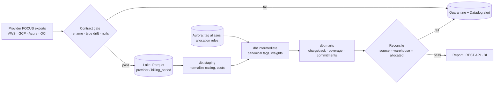

# FinOps Attribution Platform

An end-to-end pipeline that turns raw multi-cloud billing data into **trusted chargeback,
tag-coverage and commitment numbers** — and refuses to publish anything that doesn't tie
back to the invoice.

Built on the FinOps Foundation's **FOCUS 1.0 sample dataset**: 100,000 anonymized real billing
line items from AWS, Azure, Oracle Cloud and a small Google Cloud slice.

```
make setup && make all      # download → ingest → dbt build → reconcile → report → tests
make drift-demo             # replay an upstream schema-change incident; watch it get blocked
make api                    # chargeback REST API on :8000
```

---

## The problems this solves

| Problem a FinOps data team actually has | What this project does | Where |
|---|---|---|
| AWS, GCP, Azure and OCI bills all have different schemas | Ingests the FOCUS open standard so one model covers every provider | `transform/models/staging/` |
| Upstream renames a field or sends `"$1,234.56"` in a cost column → silent NULLs, fake dip in spend | Contract gate reads every column as text, detects renames and type drift, quarantines the batch | `ingestion/validate_contract.py` |
| Tags are inconsistent (`business_unit` vs `org` vs `" org"` vs `CostCenter`) | Governed alias table resolves them to one canonical owner | `seeds/tag_key_aliases.csv`, `int_charge_tags.sql` |
| Untagged / shared spend makes chargeback disputed | Rule-driven allocation: compute by usage hours, everything else by spend share, credits by spend; leftovers go to an explicit `UNALLOCATED` bucket | `seeds/shared_cost_rules.csv`, `fct_cost_allocated.sql` |
| Finance doesn't trust the numbers | Three-way reconciliation (source file → warehouse → allocated) with an audit table; dbt test fails the build if one cent drifts | `reconciliation/reconcile.py`, `tests/assert_allocation_reconciles_to_source.sql` |
| Savings Plans / CUDs bought on guesswork | Coverage + unused-commitment waste, plus a safe commitment floor sized from the low percentile of daily on-demand spend | `mart_commitment_coverage.sql`, `mart_commitment_recommendation.sql` |
| Re-runs double-count | SHA-256 batch fingerprints + manifest; re-running the same file is a no-op | `ingestion/load_raw.py` |
| Downstream tools need cost data without warehouse access | Read-only REST API | `api/main.py` |

## Architecture



| Layer | Local (runs on a laptop) | Production equivalent (included) |
|---|---|---|
| Ingestion | `ingestion/load_raw.py` (DuckDB) | `ingestion/glue/focus_to_parquet.py` (AWS Glue / PySpark) |
| Lake + query | Partitioned Parquet on disk | S3 + Glue Catalog with partition projection + Athena workgroup with scan cap |
| Reference data | dbt seeds | Aurora Serverless v2 (scales to zero) |
| Warehouse | DuckDB | Snowflake (`prod` target in `transform/profiles.yml`) |
| Orchestration | `make pipeline` | Airflow DAG with SLA + Datadog failure events |
| IaC | — | Terraform (`terraform validate` passes) |
| CI | `make test` | GitHub Actions: tests, dbt build, drift regression, `terraform validate` |

## Results on the sample data

| | |
|---|---|
| Line items processed | 100,000 across 4 providers |
| Usage spend attributed directly by tags | 96.4% (after alias resolution) |
| Reconciliation | 5/5 checks pass; allocated total equals source to < $0.000001 |
| Unallocated spend | $0.00 |
| dbt nodes | 22 models, seeds and data tests, all passing |
| pytest | 16 tests (contract unit tests, warehouse integration, API) |
| AWS commitment coverage | 0.7% of compute — recommended safe floor covers ~14% of on-demand |

Amounts in the sample are scaled down by the FinOps Foundation; the ratios are the point.

## Key design decisions

- **Effective cost for chargeback, billed cost for invoice reconciliation.** Effective cost
  amortizes commitment purchases across the usage they covered, so teams aren't charged a
  lump sum the month a Savings Plan is bought. Both are carried through allocation so either
  can be reconciled.
- **Credits follow spend, not usage.** A large credit allocated by compute hours would hand most
  of the discount to whoever runs the most VMs. Credits, tax and adjustments get their own pool.
- **Allocation falls back, never drops.** Rule → category spend share → provider spend share →
  `UNALLOCATED`. Every fallback is labelled in `allocation_method`, so a disputed number can be
  traced to the rule that produced it.
- **Detect drift, don't coerce it.** The gate reads all columns as strings; a loader that infers
  types would have turned `"$1.23"` into NULL and passed.
- **Commit to the floor, not the average.** Commitment sizing uses the 10th percentile of daily
  on-demand spend so the commitment is fully used even on quiet days.

## Project structure

```
finops-attribution-platform/
├── ingestion/
│   ├── contracts/focus_v1_contract.yaml   # required columns, types, null thresholds
│   ├── validate_contract.py               # rename + type-drift detection
│   ├── load_raw.py                        # idempotent partitioned landing + manifest
│   └── glue/focus_to_parquet.py           # AWS Glue PySpark version
├── transform/                             # dbt project (DuckDB dev / Snowflake prod)
│   ├── seeds/                             # tag_key_aliases, shared_cost_rules
│   ├── models/staging/                    # stg_focus__charges
│   ├── models/intermediate/               # int_charge_tags, int_charges_attributed, int_allocation_weights
│   ├── models/marts/                      # fct_cost_allocated, chargeback, tag coverage, commitments, app cost
│   └── tests/                             # reconciliation + weight invariants
├── reconciliation/reconcile.py            # 3-way reconciliation, writes audit.reconciliation_runs
├── orchestration/airflow/dags/            # daily DAG with SLA + Datadog alerting
├── infra/terraform/                       # S3, Glue, Athena, IAM, Aurora Serverless v2
├── api/main.py                            # FastAPI: /v1/chargeback, /v1/tag-coverage, /v1/commitments
├── report/build_report.py                 # self-contained HTML report for Finance
├── scripts/                               # data download, schema-drift incident replay
├── tests/                                 # pytest
└── .github/workflows/ci.yml
```

## Limitations (honest list)

- The Google Cloud slice of the public sample is only 2 rows, so GCP is exercised by the schema
  but not by meaningful volume. Plugging in a real BigQuery billing export (FOCUS view) is the
  obvious next step.
- The sample is row-sampled, so hourly series are sparse; commitment sizing uses daily buckets.
- Telemetry-driven allocation here uses compute consumption from the bill itself. In production
  the driver would come from observability data (e.g. Datadog metrics per service).
- Savings estimates use a configurable blended discount rate, not live pricing.
- No Scala code; the Spark job is PySpark.

## Data source

FinOps Foundation, *FOCUS Sample Data* (FOCUS 1.0),
https://github.com/FinOps-Open-Cost-and-Usage-Spec/FOCUS-Sample-Data — anonymized real billing
data for AWS, Google Cloud, Microsoft and Oracle.
